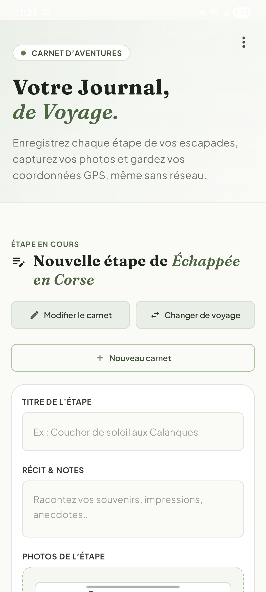
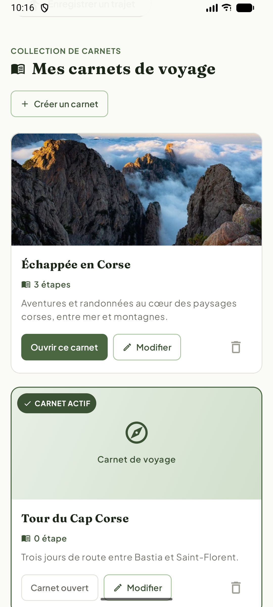
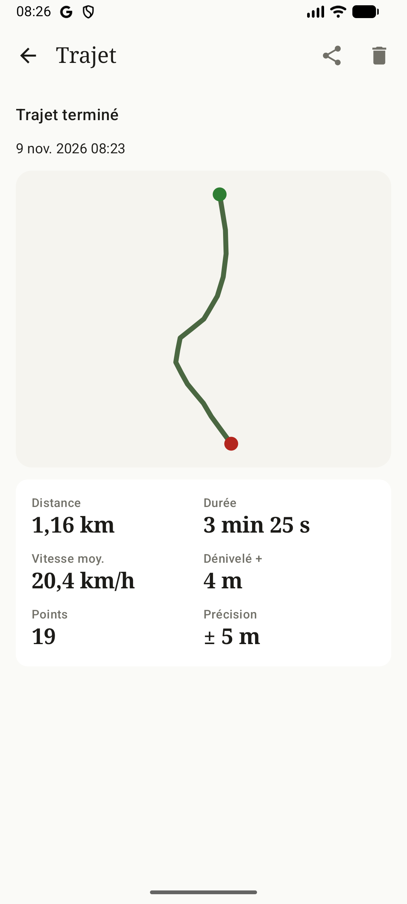
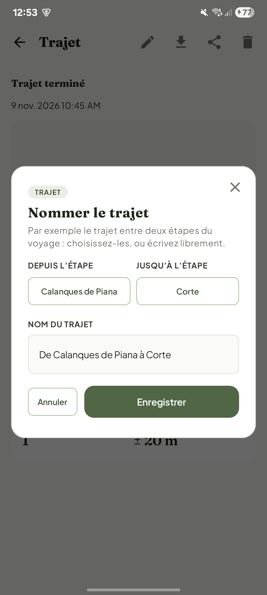

# Journal de Voyage — application Android

Portage natif (Kotlin, Jetpack Compose) de la PWA **Journal de Voyage** — [journalvoyage.netlify.app](https://journalvoyage.netlify.app/) — réalisé dans le cadre du TP Android du module *Développement d'applications mobiles* (M2 Informatique, Università di Corsica, novembre 2026).

L'application reprend **le même front et les mêmes fonctionnalités que la PWA** (carnets de voyage, étapes avec récit, photos et position, fonctionnement hors ligne, synchronisation différée), et y ajoute :

- **une fonctionnalité qu'une PWA ne peut pas offrir** : l'enregistrement d'un trajet GPS en service de premier plan, qui continue écran éteint et application fermée ;
- **la mesure d'audience** : trois événements Firebase Analytics, soumis au consentement de l'utilisateur.

| | |
|---|---|
| Vidéo de démonstration | [`video/journal-de-voyage-demo.mp4`](video/journal-de-voyage-demo.mp4) (Git LFS) |
| APK prêt à installer | [`apk/journal-de-voyage-2.1.apk`](apk/journal-de-voyage-2.1.apk) |
| Version | 2.1 (versionCode 3) — Android 8.0+ (API 26), cible API 37 |

<p align="center">
  
  
  
  
</p>

---

## Sommaire

1. [Installer et tester](#1-installer-et-tester)
2. [Fonctionnalités](#2-fonctionnalités)
3. [De la PWA à l'application Android](#3-de-la-pwa-à-lapplication-android)
4. [Architecture](#4-architecture)
5. [Choix techniques](#5-choix-techniques)
6. [Fonctionnalité native : l'enregistreur de trajet](#6-fonctionnalité-native--lenregistreur-de-trajet)
7. [Mesure d'audience](#7-mesure-daudience)
8. [Tests et vérifications](#8-tests-et-vérifications)
9. [Difficultés rencontrées](#9-difficultés-rencontrées)
10. [Sécurité et données publiées](#10-sécurité-et-données-publiées)
11. [Crédits](#11-crédits)

---

## 1. Installer et tester

### Option A — installer l'APK (le plus rapide)

L'APK de `apk/` est la version release, signée avec la clé du dépôt (`debug.keystore`) : l'App Link est donc vérifié.

```bash
adb install apk/journal-de-voyage-2.1.apk
```

Ou copier le fichier sur le téléphone et l'ouvrir (autoriser l'installation depuis cette source). Un appareil avec les **Google Play Services** est nécessaire pour la localisation et les notifications push.

### Option B — compiler depuis les sources

Prérequis : Android Studio récent (Android Gradle Plugin 9.4), SDK Android **API 37**. Le JDK requis par Gradle est téléchargé automatiquement (toolchain).

```bash
git clone https://github.com/Thibaut-Renaut/app-voyage.git
cd app-voyage
./gradlew installDebug        # ou, dans Android Studio : Open › Run 'app'
```

Aucune configuration n'est nécessaire : les valeurs par défaut (hôte de la PWA, endpoint de synchronisation) sont définies dans `app/build.gradle.kts`. Elles peuvent être surchargées dans `local.properties` :

```properties
PWA_HOST=journalvoyage.netlify.app
SYNC_BASE_URL=https://httpbin.org/
# Signature release (facultatif)
RELEASE_STORE_FILE=release.jks
RELEASE_STORE_PASSWORD=…
RELEASE_KEY_ALIAS=…
RELEASE_KEY_PASSWORD=…
```

| Commande | Effet |
|---|---|
| `./gradlew assembleDebug` / `assembleRelease` | APK dans `app/build/outputs/apk/` |
| `./gradlew testDebugUnitTest` | tests unitaires (calculs du tracé, export GPX) |
| `./gradlew connectedDebugAndroidTest` | tests des migrations Room sur un appareil connecté |

---

## 2. Fonctionnalités

### Reprises de la PWA (même écran, mêmes textes, même charte)

- **Page unique** : en-tête, formulaire « Nouvelle étape de *carnet actif* », itinéraire numéroté, collection de carnets, destinations inspirantes, pied de page.
- **Carnets de voyage** : création (titre, description, photo vitrine), modification, suppression avec confirmation, changement de carnet actif ; le dernier carnet ne peut pas être supprimé.
- **Étapes** : titre, récit, position GPS, photos (appareil photo ou galerie, plusieurs à la fois), suppression.
- **Hors ligne d'abord** : toutes les données sont lisibles et modifiables sans réseau ; les étapes créées hors ligne sont envoyées automatiquement au retour du réseau, avec un statut « En attente de sync » / « Synchronisé ».
- **Retours visuels** : toasts, indicateur « Mode hors ligne » / « Connexion rétablie ».
- **Charte** : polices Fraunces et Plus Jakarta Sans, palette, rayons et composants repris de `style.css`.

### Propres à l'application Android

- **Enregistreur de trajet GPS** (section 6) : tracé en direct, distance, durée, vitesse, dénivelé ; plusieurs trajets par carnet, nommables (« De *étape* à *étape* ») ; export GPX (Strava, Komoot…).
- **Notifications** : confirmation de synchronisation, notifications push (FCM) ouvrant directement l'étape concernée.
- **Intents** : partage d'une étape (texte et photos), ouverture de la position dans une application de cartes, réception d'un texte ou d'une photo partagés depuis une autre application, ouverture de la PWA.
- **App Link** : l'URL de la PWA ouvre l'application.
- **Mesure d'audience** avec consentement (section 7).

Les éléments propres au navigateur (fenêtre d'installation, bandeau de mise à jour du Service Worker, fichiers de référencement) n'ont pas d'équivalent pertinent dans une application installée et n'ont pas été repris.

---

## 3. De la PWA à l'application Android

| PWA | Application Android | Code |
|---|---|---|
| `index.html` + `app.js` | `HomeScreen` (Compose) + `HomeViewModel` | `ui/home/` |
| Classes CSS | un composable par composant, mêmes valeurs | `ui/common/Pwa.kt`, `ui/theme/` |
| Modales | `Dialog` Compose, état conservé dans le `SavedStateHandle` | `ui/home/VoyageDialogs.kt` |
| IndexedDB (`voyages`, `etapes`) | Room (`voyages`, `etapes`, `photos`, `trajets`, `track_points`) | `data/local/` |
| Object store `outbox` | colonne `etapes.synced` | `data/local/Daos.kt` |
| Background Sync, événement `online` | WorkManager (travail unique, contrainte réseau) | `work/SyncWorker.kt` |
| `localStorage` | DataStore | `data/local/Settings.kt` |
| Push API + Service Worker | Firebase Cloud Messaging | `notif/` |
| Permissions du navigateur | permissions runtime | `ui/permissions/PermissionFlow.kt` |
| `manifest.json` | `AndroidManifest.xml`, icône adaptative, splash screen | `app/src/main/` |
| URL | App Link vérifié | `assetlinks.json` de la PWA |
| Photos en base64 dans IndexedDB | fichiers JPEG privés, chemin en base | `data/PhotoStore.kt` |

L'API de synchronisation (`POST https://httpbin.org/post`), le format des données envoyées et les données de démonstration sont identiques à ceux de la PWA.

---

## 4. Architecture

```
UI (Jetpack Compose)  ── événements ──▶  ViewModel (StateFlow, SavedStateHandle)
        ▲                                      │
        └────────── état observé ──────────────┤
                                               ▼
                                   JournalRepository  — source de vérité unique
                 ┌──────────────────┬──────────┴─────────┬────────────────────┐
                 ▼                  ▼                    ▼                    ▼
           Room (SQLite)        DataStore           PhotoStore          Retrofit / OkHttp
   carnets, étapes, photos,   carnet actif,     filesDir/photos,      synchronisation
   trajets, points GPS        consentement,      exports GPX           (httpbin.org)
                              jeton FCM

Hors de l'UI : SyncWorker (WorkManager) · TrackingService (foreground service)
               JournalMessagingService (FCM) — tous passent par le repository.
```

- **L'interface ne détient aucune donnée** : elle observe les `StateFlow` du ViewModel et lui transmet les actions de l'utilisateur.
- **Room est la source de vérité** : toute écriture passe par la base, dont les `Flow` mettent à jour les écrans, y compris quand l'écriture vient du worker de synchronisation ou du service de trajet. Les composants n'échangent jamais de données directement.
- **Injection manuelle** (`JournalContainer`, initialisé dans `Application.onCreate`) : les objets existent avant toute Activity, tout worker et tout service, y compris lorsque le système relance le process pour une tâche en arrière-plan.

```
app/src/main/java/corsica/universita/journalvoyage/
├── JournalApp.kt, MainActivity.kt   application, conteneur, Activity unique et intents entrants
├── data/                            repository, modèles, photos, export GPX, état du réseau
│   ├── local/                       Room (entités, DAO, base et migrations), DataStore
│   ├── remote/                      Retrofit
│   └── location/                    position ponctuelle
├── tracking/                        TrackingService, calculs du tracé (TrackMath)
├── work/                            SyncWorker
├── notif/                           canaux, notifications, réception FCM
├── analytics/                       mesure d'audience
└── ui/                              navigation, accueil, détail d'étape, trajet, permissions, thème
app/schemas/                         schéma Room exporté pour chaque version (1, 2, 3)
```

---

## 5. Choix techniques

### Interface et cycle de vie

| Situation | Mécanisme | Effet |
|---|---|---|
| Données affichées | ViewModel + `StateFlow` (`stateIn`, `WhileSubscribed(5 s)`) | survit à la rotation ; la requête Room n'est pas relancée |
| Brouillons (étape, carnet), fenêtre ouverte | `SavedStateHandle` | survit à la rotation **et** à la mort du process |
| Caméra ouverte, fenêtres locales | `rememberSaveable` | idem |
| Écran courant | Navigation 3, `rememberNavBackStack` (clés sérialisables) | idem |
| Données métier | Room, DataStore, fichiers | persistantes |

Les photos sont conservées sous forme de **chemins**, jamais d'images, dans l'état sauvegardé, dont la taille est limitée. Aucune opération longue ne s'exécute sur le thread principal : Room et Retrofit utilisent des fonctions `suspend`, les images sont décodées sur `Dispatchers.IO`, en taille réduite.

### Données

- **Room ou DataStore** : Room pour les données structurées et interrogées (carnets, étapes, photos, trajets) ; DataStore pour quatre valeurs isolées (carnet actif, consentement, jeton FCM, date de la dernière session).
- **Migrations** : chaque évolution du schéma incrémente la version et fournit une migration (`MIGRATION_1_2` : tables des trajets, `MIGRATION_2_3` : nom des trajets). Les schémas sont exportés dans `app/schemas/` et versionnés ; `fallbackToDestructiveMigration` n'est jamais utilisé.
- **Photos** : fichiers dans le stockage privé de l'application (aucune permission de stockage), supprimés avec l'étape ou le carnet correspondant.

### Synchronisation

Une étape est **d'abord écrite dans Room** (`synced = 0`), puis son envoi est confié à WorkManager : `enqueueUniqueWork("sync", KEEP)` avec une contrainte de réseau. Le système choisit le moment d'exécution et relance le process si nécessaire, même après la fermeture de l'application. Les erreurs réseau, 429 et 5xx déclenchent une nouvelle tentative (backoff exponentiel à partir de 30 s) ; les autres erreurs 4xx sont abandonnées. Le statut affiché provient de la base, pas de WorkManager.

### Notifications

Trois canaux (synchronisation, messages push, trajet en cours), créés au démarrage de l'application. La permission `POST_NOTIFICATIONS` est demandée à la suite d'une action de l'utilisateur, jamais au lancement, et `areNotificationsEnabled()` est vérifié avant chaque notification. Les notifications push ouvrent l'étape visée par un `PendingIntent` (`FLAG_IMMUTABLE`, un `requestCode` par cible) ; les données personnalisées de la console Firebase, transmises sous forme de chaînes, sont prises en charge.

### Permissions

`PermissionFlow` modélise quatre états : jamais demandée, accordée, refusée une fois (une explication précède la nouvelle demande), refusée définitivement (seuls les réglages permettent de l'accorder). L'état est relu à chaque retour dans l'application. Chaque permission est demandée au moment du geste qui en a besoin, et l'application reste utilisable sans : étape sans position, photo depuis la galerie via le sélecteur système, qui ne nécessite aucune permission.

| Permission | Usage |
|---|---|
| `CAMERA` | prendre une photo d'étape |
| `ACCESS_FINE_LOCATION` / `ACCESS_COARSE_LOCATION` | position d'une étape, enregistrement d'un trajet |
| `POST_NOTIFICATIONS` | synchronisation, push, trajet en cours |
| `FOREGROUND_SERVICE`, `FOREGROUND_SERVICE_LOCATION` | service de trajet (permissions normales) |
| `INTERNET`, `ACCESS_NETWORK_STATE` | synchronisation, indicateur réseau |

### Manifest, intents et App Link

- `exported` explicite : l'Activity est exposée (lanceur, partage, App Link), les services et le `FileProvider` ne le sont pas.
- **App Link** : `autoVerify` sur `https://journalvoyage.netlify.app` ; le fichier `/.well-known/assetlinks.json` de la PWA déclare le package et l'empreinte SHA-256 de la clé de signature. État vérifiable avec `adb shell pm get-app-links corsica.universita.journalvoyage` → `verified`.
- **Partage** : `ACTION_SEND` / `ACTION_SEND_MULTIPLE` ; les fichiers privés sont exposés par le `FileProvider` avec `FLAG_GRANT_READ_URI_PERMISSION`, limité au fichier partagé.
- **Signature** : `versionCode` incrémenté à chaque version ; une clé release peut être configurée dans `local.properties` (à défaut, la release est signée avec la clé du dépôt).

---

## 6. Fonctionnalité native : l'enregistreur de trajet

**Pourquoi une PWA ne le permet pas.** Dans un navigateur, `navigator.geolocation.watchPosition()` s'interrompt dès que l'onglet passe en arrière-plan ou que l'écran s'éteint, et un Service Worker n'a pas accès à la géolocalisation : impossible d'enregistrer un itinéraire complet.

**Ce que le système accorde.** `TrackingService` est un service de premier plan de type `location`. En échange d'une notification permanente (chronomètre, distance, bouton *Arrêter*), Android maintient le process et continue de fournir la position **écran éteint, application retirée des récentes et en mode Doze**. Le service étant démarré depuis l'application au premier plan, la permission « pendant l'utilisation » suffit : aucun accès à la position en arrière-plan n'est demandé.

**Fonctionnement.**

1. `startForegroundService()`, puis `startForeground()` dans les 5 secondes (Android 14 y vérifie la permission de localisation ; une erreur est interceptée et mesurée).
2. `FusedLocationProviderClient` en haute précision : une position toutes les 5 s au plus, après 5 m de déplacement.
3. Filtrage : relevés de précision supérieure à 50 m, ou à moins de 3 m du précédent (bruit à l'arrêt), ignorés.
4. Chaque point est enregistré dans Room avec la distance cumulée (formule de haversine), dans une même transaction ; l'écran du trajet observe la table et se met à jour en direct.
5. Le tracé est dessiné sur un `Canvas` (projection équirectangulaire), sans SDK de cartographie : aucune clé d'API et un fonctionnement hors ligne.
6. Statistiques : distance, durée, vitesse moyenne, dénivelé positif (seuil de 3 m contre le bruit de l'altitude GPS), précision.
7. `START_NOT_STICKY` : un enregistrement n'est jamais relancé à l'insu de l'utilisateur ; un trajet interrompu par l'arrêt du process est clos au lancement suivant, à l'heure de son dernier point.

**Organisation.** Un carnet peut contenir plusieurs trajets. Chaque trajet peut être nommé à partir des étapes du carnet (« De *étape* à *étape* »), ce qui est proposé à l'arrêt de l'enregistrement. Il peut être exporté au format **GPX 1.1**, enregistré via le sélecteur de fichiers du système ou partagé. Import Strava : strava.com › *+* › *Importer une activité*.

---

## 7. Mesure d'audience

Firebase Analytics, dans le même projet Firebase que FCM. Le SDK met les événements en file sur l'appareil et les envoie par lots ; hors ligne, ils sont conservés.

| Objectif | Événement | Déclencheur |
|---|---|---|
| Activation | `first_etape_created` | première étape créée (une fois par installation) |
| Rétention | `return_visit` | ouverture de l'application un autre jour (`days_since_last`) |
| | `notif_clicked` | ouverture depuis une notification (`push`, `sync`, `trajet`) |
| Fonctionnalité native | `trajet_started`, `trajet_completed`, `trajet_failed` | usage et réussite de l'enregistreur (`points`, `distance_m`, `duration_s`, `reason`) |

**Consentement (RGPD).** La collecte est désactivée par défaut (`firebase_analytics_collection_enabled = false`) et n'est activée qu'après acceptation explicite. Le choix est modifiable à tout moment depuis le menu de l'application. Aucun contenu saisi (récits, photos, positions) n'est transmis.

Observation en direct : `adb shell setprop debug.firebase.analytics.app corsica.universita.journalvoyage`, puis console Firebase › Analytics › DebugView.

---

## 8. Tests et vérifications

### Tests automatisés

- `TrackMathTest` (JVM) : distance, filtrage des relevés, dénivelé, statistiques, export GPX.
- `MigrationTest` (appareil) : migrations 1 → 2 → 3 et 2 → 3, validées contre les schémas exportés, sans perte de données.

### Vérifications sur appareil

Validées sur Samsung Galaxy S21 (Android 15) et sur émulateur (API 36) :

| Vérification | Méthode |
|---|---|
| Mode avion : l'application s'ouvre et affiche ses données | activer le mode avion (et couper le Wi-Fi s'il reste actif) |
| Retour du réseau : l'étape créée hors ligne part seule, application fermée | fermer l'application, rétablir le réseau → notification « Étapes synchronisées » |
| Mise à jour sans perte de données | installation par-dessus la version précédente (`adb install -r`) ; `MigrationTest` |
| Rotation et mort du process | rotation pendant la saisie ; `adb shell am kill corsica.universita.journalvoyage` en arrière-plan |
| Notification push, application fermée, ouvrant le bon écran | console Firebase, donnée personnalisée `etapeId` ; sans accès à la console : `adb shell am start -n corsica.universita.journalvoyage/.MainActivity --es etapeId 1` |
| Permission refusée deux fois | `adb shell pm revoke corsica.universita.journalvoyage android.permission.CAMERA`, puis refuser deux fois |
| App Link vérifié | `adb shell pm get-app-links corsica.universita.journalvoyage` |
| Trajet écran éteint / application fermée / Doze | `adb shell dumpsys activity services corsica.universita.journalvoyage` (`isForeground=true`, type location) ; `adb shell dumpsys deviceidle force-idle` |
| Événements Analytics | DebugView |

---

## 9. Difficultés rencontrées

| Problème | Cause | Solution |
|---|---|---|
| Plantage « backstack cannot be empty » lors d'un double appui sur Retour | le second appui atteignait l'écran en cours de fermeture et retirait la racine de la pile | chaque écran ne retire que sa propre entrée, et seulement si elle est au sommet |
| Saisie ignorée dans les fenêtres après réinitialisation d'un formulaire | `SavedStateHandle.remove()` détache le `StateFlow` obtenu par `getStateFlow()` | réinitialisation par valeurs par défaut, jamais par suppression de clé |
| Événements de rétention perdus au démarrage à froid | l'événement était émis avant la lecture asynchrone du consentement | consentement relu dans DataStore avant chaque envoi |
| Indicateur « en ligne » alors que la synchronisation attendait | réseau présent mais non validé ; WorkManager exige un réseau validé | même critère (`NET_CAPABILITY_VALIDATED`) pour l'indicateur |
| App Link non vérifié juste après la mise en ligne de `assetlinks.json` | cache de l'API Digital Asset Links (environ 30 min) | nouvelle vérification après expiration |
| Altitude figée sur l'émulateur | limite de l'émulateur | calcul validé par tests unitaires et sur appareil réel |

---

## 10. Sécurité et données publiées

- **`app/google-services.json`** : configuration du client Firebase. La clé d'API qu'il contient identifie le projet et n'est pas un secret (elle figure dans tout APK distribué) ; l'accès aux données est contrôlé côté Firebase, et la clé peut être restreinte au package de l'application dans la console Google Cloud.
- **`debug.keystore`** : clé de développement partagée, versionnée pour que toute compilation produise la même signature (et donc un App Link vérifié). Elle n'est pas destinée à une publication sur le Play Store ; une clé release se configure dans `local.properties`, exclu du dépôt comme les fichiers `*.jks`.
- Aucun autre identifiant, mot de passe ou jeton n'est présent dans le dépôt. Le jeton FCM de l'appareil n'est affiché (menu *Copier mon jeton FCM*) que dans les builds debug, à des fins de test.

---

## 11. Crédits

- Projet basé sur le projet de départ du cours (*Carnet*).
- Polices Fraunces et Plus Jakarta Sans — SIL Open Font License ([`docs/licences/OFL-polices.txt`](docs/licences/OFL-polices.txt)).
- Photographies et textes de démonstration : ceux de la PWA Journal de Voyage.
